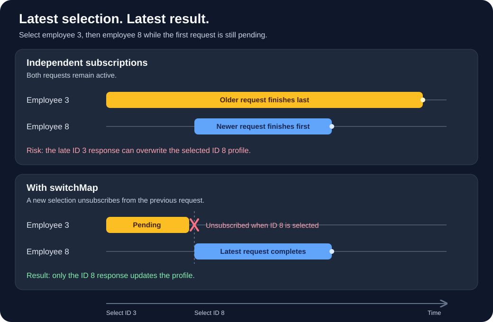

# Employee Directory

An Angular employee directory demonstrating REST requests, route parameters, signals, and RxJS request cancellation with `switchMap`.

## Features

- Browse 10 employees from DummyJSON and open individual profiles.
- Navigate between previous and next employee IDs without leaving the details page.
- Refresh the list or profile, with loading and error feedback.
- Track list refresh clicks with an Angular signal.
- Validate employee IDs and handle missing profiles.
- Navigate between Dashboard, Employees, Settings, About, and a fallback page.

This is a read-only learning project using sample API data. It does not require an API key or a local backend. Internet access is required to retrieve employees.

## Run locally

Use Node.js 24.15 or later in the Node 24 release line (verified with Node 24.22.1) and npm.

```bash
git clone https://github.com/iiMedR/employee-repository-Angular.git
cd employee-repository-Angular
npm ci
npm start
```

Open http://localhost:4200 and select **Employees**. Choose **View Details** to open a profile, then use **Previous Employee**, **Next Employee**, or **refresh**.

## Build and test

```bash
npm run build
npm test -- --watch=false
```

The production browser files are written to `dist/employee-directory/browser/`. When deploying to static hosting, configure a fallback to `index.html` so links such as `/employees/3` work when opened directly.

## How switchMap works



Suppose you select employee **ID 3**, then select **ID 8** before the first request finishes. With independent subscriptions, ID 3 might finish last and overwrite ID 8. `switchMap` unsubscribes from the previous inner observable when a new source value arrives, so only the newest request can update the view.

For Angular `HttpClient`, unsubscribing aborts an in-progress client request. This does not guarantee that a server has stopped processing it. Use this pattern for replaceable reads such as profiles or search results; avoid it for writes that must all complete.

### Route-driven employee details

A minimal version of the pattern used in `src/app/pages/employee-details/employee-details.ts`:

```ts
import { DestroyRef, inject } from '@angular/core';
import { takeUntilDestroyed } from '@angular/core/rxjs-interop';
import { ActivatedRoute } from '@angular/router';
import { catchError, map, of, switchMap } from 'rxjs';

private route = inject(ActivatedRoute);
private employeeService = inject(EmployeeService);
private destroyRef = inject(DestroyRef);

ngOnInit(): void {
  this.route.paramMap.pipe(
    map(params => Number(params.get('id'))),
    switchMap(id => {
      if (!Number.isSafeInteger(id) || id <= 0) return of(null);
      return this.employeeService.getEmployeeById(id).pipe(
        catchError(() => of(null))
      );
    }),
    takeUntilDestroyed(this.destroyRef)
  ).subscribe(employee => this.employee.set(employee));
}
```

The actual component also resets loading and error state, reports invalid IDs and HTTP failures, and combines route changes with a refresh `Subject`. Refresh emits into the existing pipeline instead of adding another route subscription. `takeUntilDestroyed` cleans up when the component is destroyed.

### Refreshing the employee list

In `src/app/pages/employees/employees.ts`, `refreshSubject` triggers requests:

```ts
state$ = this.refreshSubject.pipe(
  startWith(undefined), // Load once when AsyncPipe subscribes.
  switchMap(() => this.employeeService.getEmployees().pipe(
    map((employees): LoadState<Employee[]> => ({
      status: 'success', data: employees
    })),
    catchError(() => of<LoadState<Employee[]>>({
      status: 'error', message: 'Unable to load employees.'
    })),
    startWith({ status: 'loading' } as LoadState<Employee[]>)
  ))
);
```

The template subscribes using `AsyncPipe`. Each refresh replaces any pending request and emits loading, then success or error. Keep `catchError` inside `switchMap` so a failed request does not terminate the outer refresh stream and later retries still work. `AsyncPipe` handles subscription cleanup automatically.

## Project layout

```text
src/app/
  components/navbar/       Shared navigation
  models/                  Employee, API response, and load-state types
  pages/                   Dashboard, employees, details, settings, about, 404
  services/employee.service.ts  HttpClient requests and API-to-model mapping
  app.routes.ts            Route definitions
```

Stack: Angular 22, TypeScript 6, RxJS 7.8, and Vitest. Employee data comes from `https://dummyjson.com/users`; the service maps user names and company details into employee records. The `active` flag is currently set to `true` for all mapped records.

References: [RxJS switchMap](https://rxjs.dev/api/operators/switchMap) and [Angular HTTP request cancellation](https://angular.dev/guide/http/making-requests#advanced-fetching-options).
